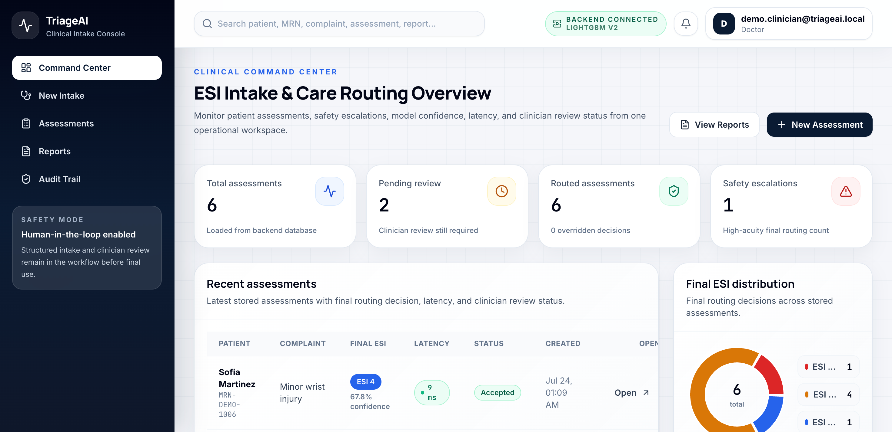
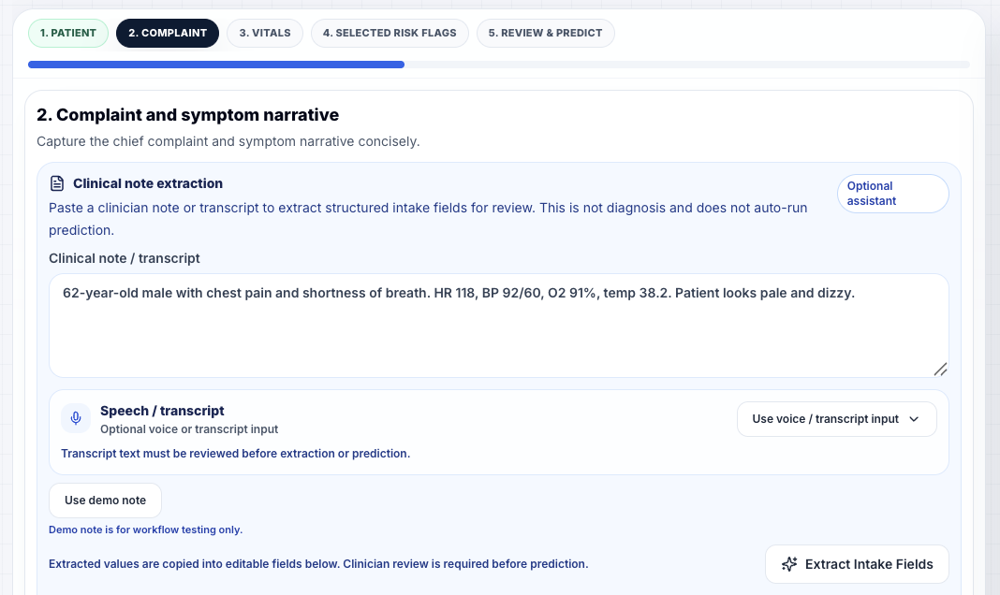
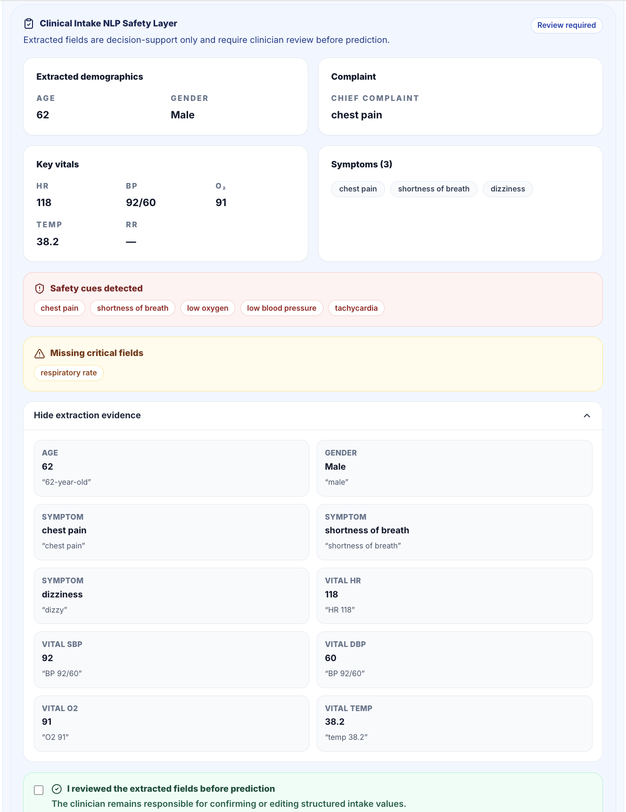
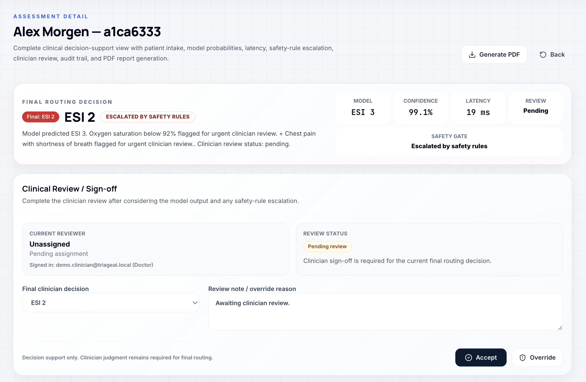
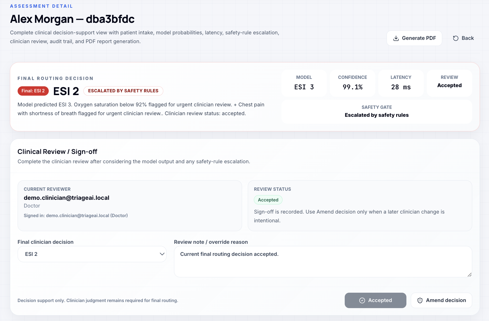
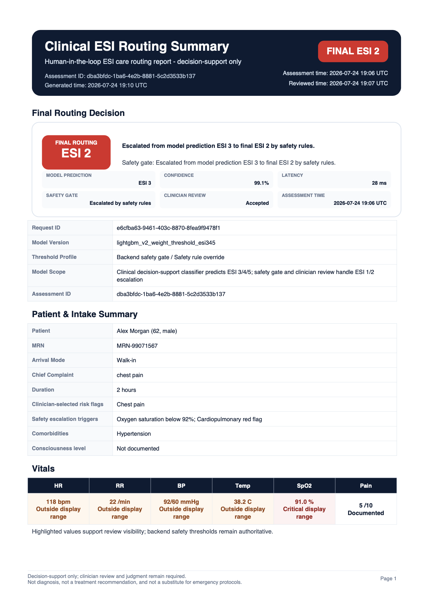
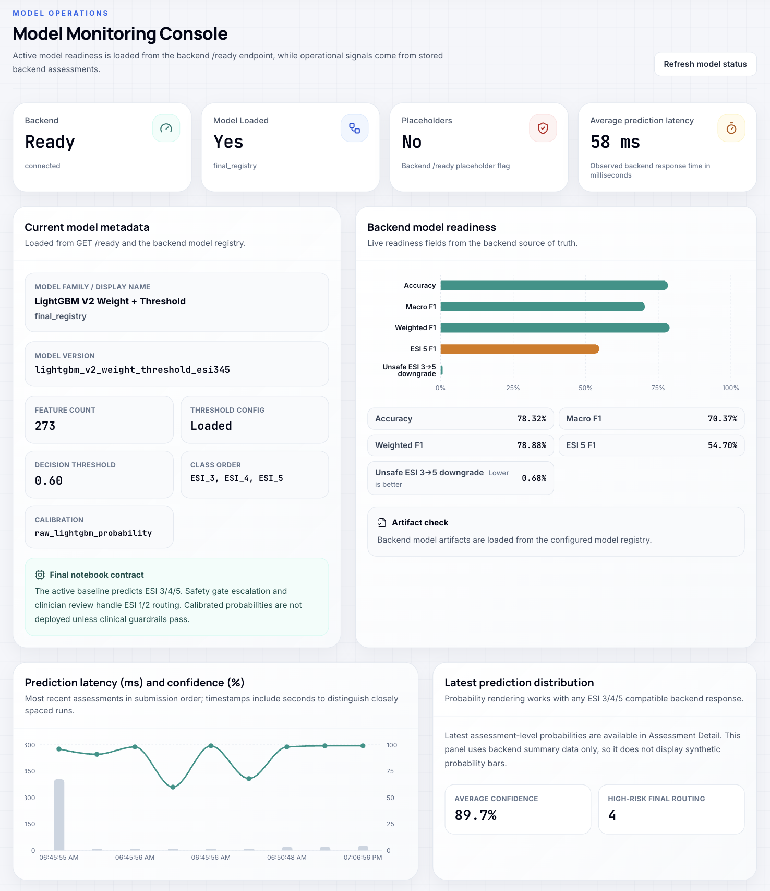
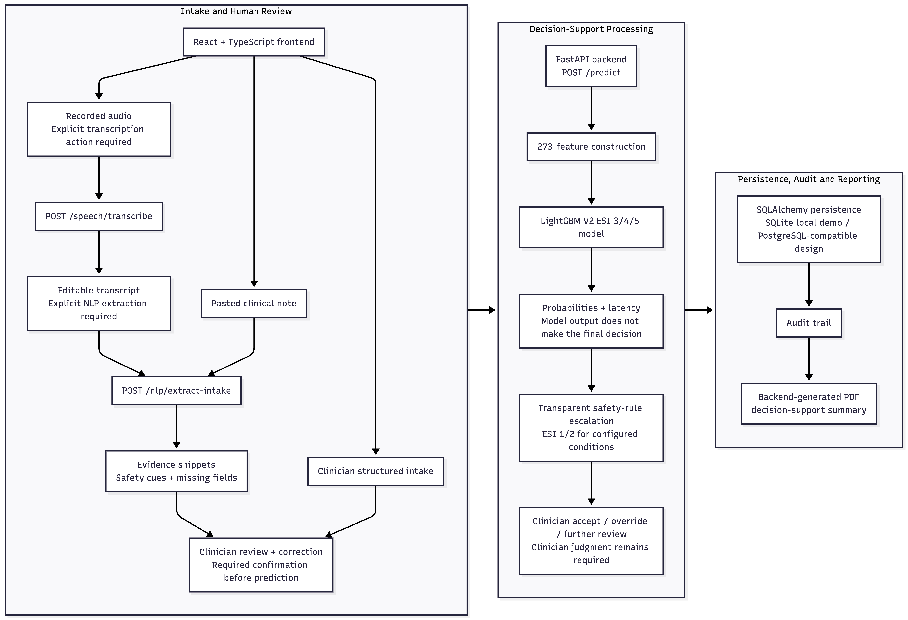

# TriageAI / SympDirect — ESI Clinical Intake & Care Routing Assistant

<div align="center">


[](https://github.com/chintan-02/triageai-esi-care-routing/actions/workflows/ci.yml)

**A review-first healthcare AI decision-support workflow for structured clinical intake, ESI care routing, safety escalation, clinician review, auditability, and PDF reporting.**

[Live Demo](https://triageai-chintan-staging.netlify.app/) · [Portfolio Case Study](https://chintan-patel-ai.netlify.app/case-studies/triageai)

</div>

---

> [!IMPORTANT]
> TriageAI is a portfolio and educational clinical decision-support workflow. It does not diagnose patients, replace clinician judgment, or operate as a validated clinical system. Live clinical use would require formal clinical validation, governance, privacy and security review, regulatory assessment, controlled deployment, and organizational approval.

---

## Project Status

**Live educational demo**, verified on October 16, 2026 (America/Edmonton).

- React/TypeScript frontend delivered by Netlify; non-root FastAPI container on Google Cloud Run.
- Real 273-feature LightGBM V2 inference, explicit safety escalation, and human review.
- Neon PostgreSQL system of record with Alembic migrations and separate migration/runtime/cleanup database roles.
- Database-backed opaque sessions, server-enforced workflow roles and owner-scoped assessments, audit and report APIs.
- Private Google Cloud Storage PDFs with authenticated downloads. Assessment-level generation refreshes a snapshot after review/input changes; historical report-ID downloads preserve the original PDF.
- Shared rate limits, workspace quotas and hourly bounded cleanup of eligible demo workspaces and report objects.
- Two HTTPS uptime checks, five operational alert policies, and verified opening/closure email delivery.
- Private candidate smoke/regression checks and image-digest-based promotion completed. Automatic public CI/CD is not configured.
- SQLite and the legacy Streamlit frontend remain local development options. Azure Speech is optional and only works when configured; live speech transcription is not claimed.

### Try the demo

1. Open [TriageAI](https://triageai-chintan-staging.netlify.app/) and choose **Start a private demo session**.
2. Enter synthetic intake or use the example note; review and correct extracted fields before prediction.
3. Inspect model output and safety escalation, then accept, override or request further review.
4. Generate a PDF from the assessment after review; inspect the audit trail and log out.

Use synthetic information only. The Doctor demo role enables a workflow demonstration; it does not verify professional credentials. Anonymous workspaces are temporary. Eligible inactive demo data is cleaned hourly after a 24-hour retention window, subject to active-session exclusions and batch limits. Cold starts can delay the first request.

See the [live operations runbook](docs/deployment/live-demo-runbook.md),
[monitoring setup](docs/deployment/monitoring.md), and
[verified deployment evidence](docs/releases/cloud-demo-2026-10-17.md).

---

## Problem Statement

Emergency intake workflows require more than a model prediction.

Clinician notes, symptoms, demographics, and vital signs must be converted into structured and reviewable information. Safety-sensitive cases need transparent escalation rules. Final routing decisions need clinician oversight, and every meaningful action should be traceable.

TriageAI combines:

- structured clinical intake
- review-first free-text extraction
- LightGBM-assisted ESI 3/4/5 classification
- transparent safety-rule escalation
- clinician accept or override review
- database persistence
- audit trail storage
- dashboard and assessment workflows
- backend-generated PDF decision-support summaries

The system is positioned as **clinical workflow decision support**, not diagnosis or autonomous triage.

---

## What the System Does

- Provides a React healthcare SaaS-style workflow with a login/demo shell and role-oriented pages.
- Captures structured patient intake through the New Assessment workflow.
- Supports recorded-audio and transcript intake for review before structured extraction.
- Converts clinician free-text notes into reviewable structured fields through the Clinical Intake NLP Safety Layer.
- Returns source-text evidence for extracted values rather than presenting unsupported fields as verified truth.
- Identifies configured safety cues and missing vital-sign information.
- Stores reviewed NLP extraction evidence in the backend audit trail.
- Calls the FastAPI backend `POST /predict` endpoint to create real backend assessments.
- Runs the final LightGBM V2 ESI 3/4/5 prediction path through the backend model registry.
- Applies transparent safety-rule escalation for high-risk intake signals.
- Supports human clinician accept, override, and needs-review actions.
- Displays assessment queue, assessment detail, command center, reports, audit trail, model monitoring, and settings pages.
- Generates official PDF decision-support summaries through the backend ReportLab service.
- Includes reviewed NLP evidence in backend-generated PDF summaries.
- Persists prediction latency and exposes it through backend responses and frontend views.
- Stores audit events server-side for prediction, review, and report-generation traceability.
- Includes a local reset and seed workflow for repeatable demonstration records.

---

## High-Level Architecture

```text
Clinician Free-Text Note or Structured Intake
                    ↓
Clinical Intake NLP Safety Layer
                    ↓
Extracted Fields + Evidence + Safety Cues + Missing Fields
                    ↓
Human Review / Correction Before Prediction
                    ↓
React Frontend
                    ↓
FastAPI Backend
                    ↓
Clinical Input Validation + Feature Builder
                    ↓
LightGBM V2 ESI 3/4/5 Model Registry
                    ↓
Safety Rule Escalation Layer
                    ↓
Neon PostgreSQL (cloud) / SQLite (local)
                    ↓
Clinician Review + Audit Trail + PDF Report
```

The frontend does not own assessment truth. React calls backend APIs, while the backend and database remain the source of truth. Official PDFs are generated by the backend, and audit events are stored server-side.

---

## Clinical Intake NLP Safety Layer

The Clinical Intake NLP Safety Layer converts clinician free-text notes into structured fields for review before prediction.

It is implemented as a deterministic, evidence-linked extraction service rather than a diagnostic chatbot.

### Extracted fields

The current response schema supports:

- age
- gender
- chief complaint
- symptom list
- heart rate
- systolic blood pressure
- diastolic blood pressure
- respiratory rate
- oxygen saturation
- temperature
- safety cues
- missing vital-sign fields
- evidence snippets showing the source text for extracted values

Every extraction response includes:

```text
requires_clinician_review = true
```

The endpoint also returns the disclaimer:

```text
Decision support only. Extracted fields require clinician review before prediction.
```

### Current safety cues

The NLP layer can identify configured cues such as:

- chest pain
- shortness of breath
- low oxygen saturation
- low blood pressure
- tachycardia
- stroke symptoms
- unresponsiveness
- seizure
- suicidal ideation
- pregnancy with abdominal pain
- severe trauma
- fever in an older adult

These cues support review and workflow escalation. They do not independently establish a diagnosis or final ESI level.

### Missing-information handling

The extraction layer does not invent vital signs that are absent from the note.

It explicitly reports missing information such as:

- respiratory rate
- oxygen saturation
- blood pressure
- heart rate
- temperature

### Example request

```bash
curl -X POST "http://localhost:8001/nlp/extract-intake" \
  -H "Authorization: Bearer $TRIAGEAI_DEMO_TOKEN" \
  -H "Content-Type: application/json" \
  -H "Authorization: Bearer $TRIAGEAI_SESSION_TOKEN" \
  -d '{
    "note_text": "62-year-old male with chest pain and shortness of breath. HR 118, BP 92/60, O2 91%, temp 38.2."
  }'
```

### Example response shape

```json
{
  "age": 62,
  "gender": "Male",
  "chief_complaint": "chest pain",
  "symptoms": [
    "chest pain",
    "shortness of breath"
  ],
  "vitals": {
    "hr": 118,
    "sbp": 92,
    "dbp": 60,
    "rr": null,
    "o2": 91,
    "temp": 38.2
  },
  "safety_cues": [
    "chest pain",
    "shortness of breath",
    "low oxygen",
    "low blood pressure",
    "tachycardia"
  ],
  "missing_fields": [
    "respiratory rate"
  ],
  "evidence": [
    {
      "field": "age",
      "value": 62,
      "text": "62-year-old"
    },
    {
      "field": "gender",
      "value": "Male",
      "text": "male"
    },
    {
      "field": "symptom",
      "value": "chest pain",
      "text": "chest pain"
    },
    {
      "field": "symptom",
      "value": "shortness of breath",
      "text": "shortness of breath"
    }
  ],
  "requires_clinician_review": true,
  "disclaimer": "Decision support only. Extracted fields require clinician review before prediction."
}
```

> The evidence list is shortened for readability. The actual response can include additional evidence records for recognized vital signs and other extracted fields.

### NLP safety boundaries

The NLP layer:

- does not diagnose patients
- does not independently assign the final ESI level
- does not replace structured clinical assessment
- does not replace clinician judgment
- does not treat extracted fields as automatically verified truth
- does not invent values for absent information
- requires review before extracted information is used in prediction

---

## AI/ML Model Details

| Field | Value |
|---|---|
| Model | LightGBM V2 Weight + Threshold |
| Task | ESI 3/4/5 classification |
| Model source | `final_registry` |
| Model version | `lightgbm_v2_weight_threshold_esi345` |
| Registry path | `model_registry/esi_345_lightgbm_v2/` |
| Feature count | 273 |
| Class order | `ESI_3`, `ESI_4`, `ESI_5` |
| Calibration method | Raw LightGBM probability retained |
| Decision threshold | `0.60` |
| Threshold configuration | Loaded from the versioned model registry |
| Placeholder model | No, when validated final-registry artifacts are available |

Verified metrics from:

```text
model_registry/esi_345_lightgbm_v2/reports/lightgbm_v2_test_metrics.json
```

| Metric | Value |
|---|---:|
| Accuracy | **78.32%** |
| Macro F1 | **70.37%** |
| Weighted F1 | **78.88%** |
| ESI 5 F1 | **54.70%** |
| Unsafe ESI 3-to-ESI 5 downgrade rate | **0.68%** |

The selected model balances overall classification quality with safety-sensitive ESI 5 behavior and downgrade-risk controls. Calibration was evaluated, but raw LightGBM probabilities were retained because calibrated challengers did not preserve all configured clinical guardrails.

### Important model artifacts

```text
model_registry/esi_345_lightgbm_v2/
├── artifact_manifest.json
├── esi_345_deployment_config.json
├── esi_345_label_mapping.json
├── esi_345_lightgbm_v2_feature_list.json
├── esi_345_lightgbm_v2_model.txt
├── esi_345_lightgbm_v2_preprocessing_artifacts.joblib
├── esi_345_lightgbm_v2_threshold_config.json
└── reports/
    └── lightgbm_v2_test_metrics.json
```

### Final source-of-truth notebook

```text
notebooks/FINAL_SOURCE_OF_TRUTH/
└── ESI_345_FINAL_DEPLOYMENT_LIGHTGBM_V2_SAFETY_TUNED_FINAL_VERDICT_CHECKED.ipynb
```

---

## Safety Rules and Human-in-the-Loop Review

The ML prediction is not accepted blindly.

The model predicts ESI 3, 4, or 5, while transparent safety rules can escalate the final routing result for urgent clinician review.

Current safety-rule triggers include:

- low oxygen saturation
- altered-consciousness wording
- chest pain with shortness of breath
- severe-bleeding wording
- pregnancy with bleeding wording

When a configured safety rule triggers, the workflow can escalate the final routing result to ESI 2 as a safety safeguard.

Clinicians can:

- accept the final routing result
- override the result
- mark the assessment as requiring further review

Review actions are persisted and recorded in the audit trail. The final acuity is a decision-support output for care routing, not a diagnosis.

---

## Backend Details

The FastAPI backend lives in:

```text
app/backend/
```

It is responsible for:

- route handling and schema validation
- health and readiness checks
- review-first clinical-note extraction
- extraction evidence and missing-field reporting
- model-registry loading
- feature building and prediction execution
- prediction-latency tracking
- safety-rule escalation
- database persistence
- clinician review workflow
- audit logging
- dashboard summaries
- backend PDF generation

### Live backend endpoints

| Method | Endpoint | Purpose |
|---|---|---|
| `GET` | `/health` | Basic API health check |
| `GET` | `/ready` | Database and model readiness, metadata, feature count, and class order |
| `POST` | `/nlp/extract-intake` | Extract reviewable structured fields from clinician free-text notes |
| `POST` | `/predict` | Create an assessment, run prediction, and persist prediction metadata |
| `POST` | `/assessments` | Create a stored assessment without running prediction |
| `GET` | `/assessments` | List stored assessments |
| `GET` | `/assessments/{assessment_id}` | Load assessment, prediction, review, audit, and report details |
| `GET` | `/assessments/{assessment_id}/audit` | Load the assessment audit trail |
| `GET` | `/assessments/{assessment_id}/report/pdf` | Get or generate the official backend PDF |
| `POST` | `/clinician-review` | Save accept, override, or needs-review action |
| `GET` | `/dashboard/summary` | Return backend dashboard summary |
| `POST` | `/reports/generate` | Compatibility report-generation endpoint |
| `GET` | `/reports/{report_id}/download` | Download a generated report |
| `POST` | `/speech/transcribe` | Review-required speech transcription with a safe unconfigured fallback |

Authentication is now provided by `/api/v1/auth/demo`, `/register`, `/login`,
`/me`, and `/logout` (all paths share the `/api/v1/auth` prefix). Workflow APIs
require a bearer session and enforce private assessment ownership. Public demo
accounts cannot grant themselves administrative privileges.

See [backend readiness and local startup](docs/deployment/backend-readiness.md)
for migrations, PostgreSQL, report storage, verification, and remaining release gates.

---

## Frontend Details

The primary frontend lives in:

```text
app/frontend/react_app/
```

### Stack

- Vite
- React
- TypeScript
- Tailwind CSS
- React Router
- Recharts
- lucide-react

### React routes

| Route | Page |
|---|---|
| `/login` | Login and demo application shell |
| `/command-center` | Command Center and dashboard |
| `/new-assessment` | New Intake |
| `/assessments` | Assessment list |
| `/assessments/:id` | Assessment detail |
| `/reports` | Reports |
| `/audit` | Audit trail |
| `/model-monitoring` | Model monitoring |
| `/settings` | Settings |

The frontend includes:

- API client services under `src/api/`
- model-status context under `src/context/ModelStatusContext.tsx`
- feature-oriented modules under `src/features/`
- loading, error, empty, and disconnected states
- real backend mode as the default assessment workflow

Backend-connected mode:

```env
VITE_USE_MOCK_API=false
VITE_API_BASE_URL=http://localhost:8001
```

`mockData.ts` and `mockApi.ts` are retained only as explicit development or test fixtures. Browser `localStorage` is not the source of truth for real assessments.

The legacy browser-side PDF helper is retained for fallback experimentation. Official reports use:

```http
GET /assessments/{assessment_id}/report/pdf
```

The New Intake workflow integrates `POST /nlp/extract-intake`, requires clinician review and correction before prediction, and preserves reviewed evidence in backend audit and report workflows.

---

## Database and Persistence

SQLAlchemy models live in:

```text
app/backend/db/models.py
```

Current entities:

- `users`
- `patients`
- `assessments`
- `predictions`
- `clinician_reviews`
- `audit_logs`
- `reports`

Local development uses SQLite:

```env
DATABASE_URL=sqlite:///./triageai.db
```

The live demo uses managed Neon PostgreSQL; SQLite is retained for local development.

The backend and database remain the source of truth. PDF records, predictions, clinician reviews, and audit events are stored server-side.

---

## Project Structure

```text
app/
├── backend/
│   ├── api/
│   │   └── routes/
│   │       ├── nlp.py
│   │       ├── predict.py
│   │       ├── assessments.py
│   │       ├── clinician_review.py
│   │       ├── dashboard.py
│   │       ├── reports.py
│   │       ├── health.py
│   │       └── speech.py
│   ├── core/
│   ├── db/
│   ├── schemas/
│   │   └── nlp.py
│   ├── services/
│   │   └── clinical_nlp/
│   └── utils/
│
└── frontend/
    ├── react_app/
    │   └── src/
    │       ├── api/
    │       ├── app/
    │       ├── components/
    │       ├── context/
    │       ├── features/
    │       ├── lib/
    │       └── types/
    └── streamlit_app/

data/
deployment/
docs/
ml/
model_artifacts/
model_registry/
└── esi_345_lightgbm_v2/
notebooks/
└── FINAL_SOURCE_OF_TRUTH/
reports/
└── generated/
scripts/
tests/
├── backend/
├── frontend/
└── ml/
```

This README shows the primary architecture rather than every repository file.

---

## Local Setup

### 1. Clone the repository

```bash
git clone https://github.com/chintan-02/triageai-esi-care-routing.git
cd triageai-esi-care-routing
```

### 2. Create and activate a virtual environment

```bash
python3.12 -m venv .venv
source .venv/bin/activate
```

On Windows:

```bash
.venv\Scripts\activate
```

### 3. Install Python dependencies

```bash
python -m pip install -r requirements-backend.txt
cp .env.example .env
python -m alembic upgrade head
```

### 4. Apply migrations and start the FastAPI backend

Use Python 3.12 for the pinned deployment runtime.

```bash
python -m alembic upgrade head
python -m uvicorn app.backend.api.main:app --reload --port 8001
```

### 5. Verify health and readiness

```bash
curl http://localhost:8001/health
curl http://localhost:8001/ready | python -m json.tool
```

### 6. Test the Clinical Intake NLP endpoint (authenticated)

First obtain a session with `POST /api/v1/auth/demo`; provide its `access_token`
as `TRIAGEAI_DEMO_TOKEN` for this request. The frontend manages this automatically.

```bash
curl -X POST "http://localhost:8001/nlp/extract-intake" \
  -H "Authorization: Bearer $TRIAGEAI_DEMO_TOKEN" \
  -H "Content-Type: application/json" \
  -d '{
    "note_text": "62-year-old male with chest pain and shortness of breath. HR 118, BP 92/60, O2 91%, temp 38.2."
  }' | python -m json.tool
```

### 7. Start the React frontend

```bash
cd app/frontend/react_app
npm ci
VITE_API_BASE_URL=http://localhost:8001 npm run dev
```

Open:

```text
http://localhost:5173
```

API documentation:

```text
http://localhost:8001/docs
```

### 8. Run the legacy Streamlit frontend

```bash
streamlit run app/frontend/streamlit_app/Home.py
```

---

## Environment Variables

Root `.env.example` includes backend settings such as:

```env
DATABASE_URL=sqlite:///./triageai.db
MODEL_REGISTRY_DIR=model_registry/esi_345_lightgbm_v2
REPORT_OUTPUT_DIR=reports/generated
```

Frontend `.env.example` includes:

```env
VITE_USE_MOCK_API=false
VITE_API_BASE_URL=http://localhost:8001
```

Cloud deployments use PostgreSQL with TLS certificate verification, secret references and explicit migrations; never put database credentials in Vite variables.

---

## Demo Reset and Seed Workflow

For screenshot-ready local demonstration data:

```bash
python scripts/reset_demo_data.py
```

This script is intended for local SQLite demonstration data only. It can back up the existing local database, clear demonstration workflow tables, seed repeatable cases, run predictions through the backend model path, save clinician review and audit records, and prepare report records.

Do not run the reset workflow against production data.

The configurable command is:

```bash
python scripts/demo_reset_seed.py --backup --reset --seed --yes
```

Additional utilities:

```bash
python scripts/validate_model_registry.py
python scripts/api_smoke_test.py --base-url http://127.0.0.1:8001
```

---

## Testing

### Backend compile check

```bash
python -m compileall app/backend
```

### Python test suite

```bash
python -m pytest
```

### React production build

```bash
cd app/frontend/react_app
npm run build
```

Current test folders:

- `tests/backend/`
- `tests/frontend/`
- `tests/ml/`

Current coverage includes:

- health and readiness
- NLP intake extraction
- prediction schemas
- safety rules
- assessment persistence
- clinician review
- dashboard summaries
- report and PDF generation
- audit behavior
- demo reset and seed safety
- React and backend contract checks
- frontend API-client behavior
- UI helper behavior
- model artifacts
- feature-builder behavior

---

## Historical Local Demo-Freeze Validation

- Historical backend baseline: 96 passing tests
- Historical frontend baseline: 14 test files and 52 passing tests
- React production build: passed
- Docker Compose full-stack run: passed
- Backend readiness: passed
- Model loaded: `true`
- Model feature count: `273`
- Model class order: `ESI_3`, `ESI_4`, `ESI_5`
- Decision threshold: `0.60`

These are historical baseline results, not current suite totals. See the dated release evidence for current validation. Software tests do not represent clinical validation.

---

## Example Demonstration Flow

1. Start the backend on port `8001`.
2. Test free-text extraction through `POST /nlp/extract-intake`.
3. Review the extracted values, evidence, safety cues, and missing fields.
4. Start the React frontend on port `5173`.
5. Confirm the top bar shows backend connected and LightGBM V2 available.
6. Create a new assessment through New Intake.
7. Review the model prediction, safety escalation, confidence, latency, and probability display.
8. Accept, override, or mark the assessment for further review.
9. Generate or download the backend PDF report.
10. Open the Audit Trail page and confirm traceability events.
11. Check Command Center counts and recent assessments.

---

## Product Walkthrough

<table>
  <tr>
    <td width="50%" valign="top">
      <strong>Command Center</strong><br>
      
      <br><sub>Operational status, workload, and recent assessments are visible in one dashboard.</sub>
    </td>
    <td width="50%" valign="top">
      <strong>Review-first clinical intake</strong><br>
      
      <br><sub>Clinical notes remain editable, and extraction begins only after an explicit user action.</sub>
    </td>
  </tr>
  <tr>
    <td width="50%" valign="top">
      <strong>Evidence-linked NLP review</strong><br>
      
      <br><sub>Extracted values are paired with evidence and must be reviewed before prediction.</sub>
    </td>
    <td width="50%" valign="top">
      <strong>Prediction and safety escalation</strong><br>
      
      <br><sub>Model output and transparent safety-rule escalation remain distinct and reviewable.</sub>
    </td>
  </tr>
  <tr>
    <td width="50%" valign="top">
      <strong>Clinician sign-off</strong><br>
      
      <br><sub>The clinician retains control through explicit accept, override, and further-review actions.</sub>
    </td>
    <td width="50%" valign="top">
      <strong>PDF decision-support summary</strong><br>
      
      <br><sub>The backend-generated report preserves the decision trail and safety disclaimer.</sub>
    </td>
  </tr>
</table>

**Model monitoring**



The monitoring view exposes the loaded model identity, verified evaluation metrics, threshold, and runtime status.

**System architecture**



The full architecture shows the deliberate review gates from intake through clinician sign-off, audit history, and PDF reporting.

[View the complete screenshot gallery](docs/assets/screenshots/)

---

## Implementation Status

### Completed

- Review-first clinical NLP extraction with source-text evidence, safety cues, and missing-information handling
- React review and correction before prediction
- Reviewed NLP evidence preserved in backend audit workflows
- Reviewed NLP evidence included in backend-generated PDF reports
- Recorded-audio and transcript intake through `POST /speech/transcribe`
- Azure Speech support when configured, with a safe backend fallback when unavailable or unconfigured
- Final LightGBM V2 ESI 3/4/5 model-registry integration
- Transparent safety escalation
- Clinician accept, override, and needs-review workflows
- Docker Compose local full-stack demonstration
- Continuous integration checks
- Repeatable demo seed and reset workflow
- UI regression coverage
- Final demo-freeze validation

### Remaining Clinical / Production Requirements

The demo now includes application authentication, managed PostgreSQL, private report storage, secrets and operational monitoring. Production use still needs a broader review, including staff identity lifecycle, recovery, independent staging, operational ownership and the following:

- Prospective clinical validation
- Workflow usability studies
- Subgroup and fairness evaluation
- Calibration and drift monitoring
- Privacy and security controls
- Governance and regulatory assessment

---

## Engineering Skills Demonstrated

This project demonstrates practical experience with:

- applied machine-learning deployment
- class-imbalanced multiclass evaluation
- threshold-tuned LightGBM inference
- model-registry integration
- clinical-note information extraction
- evidence-linked NLP outputs
- FastAPI backend engineering
- React and TypeScript frontend integration
- typed API contracts
- SQLAlchemy persistence
- human-in-the-loop decision support
- transparent safety escalation
- auditability and traceability
- backend PDF generation
- automated testing
- cloud deployment, private candidate verification, rollback planning and operational alerting
- responsible AI boundaries

---

## Accuracy and Honesty

All model metrics listed in this README come from the final selected LightGBM V2 evaluation artifacts.

The project avoids unsupported clinical and technical claims. It treats human review, safety escalation, auditability, uncertainty through missing-information reporting, and transparent limitations as core system requirements.

The complete review-first NLP workflow is implemented, including clinician correction before prediction, reviewed evidence storage in the audit trail, and reviewed evidence inclusion in backend-generated PDF reports.

---

## Author

**Chintan Patel**

- [Portfolio](https://chintan-patel-ai.netlify.app/)
- [LinkedIn](https://www.linkedin.com/in/chintan-patel-ai/)
- [GitHub](https://github.com/chintan-02)

---

## License and Use

This repository is intended for portfolio, educational, research, and software-engineering demonstration purposes.

It is not intended for live clinical use without the validation, governance, security, privacy, and regulatory controls described in this README.

---

## Run with Docker Compose

The full local demo can run with Docker Compose using the FastAPI backend and React frontend.

```bash
docker compose up --build
```

Backend:

```text
http://localhost:8001
```

Frontend:

```text
http://localhost:5173
```

Health checks:

```bash
curl http://localhost:8001/health
curl http://localhost:8001/ready
```

Stop the stack:

```bash
docker compose down
```

Docker Compose uses a local SQLite volume for demo data and a generated reports volume for PDF outputs. The React frontend connects to the FastAPI backend through `VITE_API_BASE_URL=http://localhost:8001`.

---

## Environment Configuration

Real environment files are intentionally ignored by Git.

Backend local example:

```bash
cp .env.example .env
```

Frontend local example:

```bash
cp app/frontend/react_app/.env.example app/frontend/react_app/.env
```

The React frontend uses Vite variables:

```text
VITE_USE_MOCK_API=false
VITE_API_BASE_URL=http://localhost:8001
```

Docker Compose defines safe demo environment values inline for local full-stack testing. Do not commit real `.env` files, secrets, generated reports, SQLite databases, `node_modules`, or `dist` outputs.

---

## Deployment Readiness

TriageAI has a verified public educational demo on Netlify and Cloud Run with Neon PostgreSQL, managed secrets, private GCS reports, HTTPS and operational alerts. This is not approval for clinical production. Independent staging data, cloud backup/restore verification, clinical validation, privacy/security review and organizational approval remain outstanding.

See: `docs/deployment/deployment_readiness_plan.md`

---

## System Architecture

TriageAI connects the React intake experience, optional Azure Speech-to-Text path, review-first clinical NLP, FastAPI services, the LightGBM V2 ESI 3/4/5 registry, safety escalation, clinician review, persistence, audit history, and PDF reporting. Every AI-assisted stage remains decision support only and requires clinician review.

See the [full system architecture and workflow](docs/architecture/triageai_system_architecture.md), including the Mermaid diagram and deployment boundaries.
