# TriageAI — Clinical Decision-Support Architecture

This is a simplified presentation view designed for recruiter and professor discussions and for export as one readable image. See the [detailed technical architecture](triageai_system_architecture.md) for the full implementation view.

```mermaid
flowchart LR
    subgraph intake["Intake and Human Review"]
        direction TB
        frontend["React + TypeScript frontend"]
        structured["Clinician structured intake"]
        note["Pasted clinical note"]
        audio["Recorded audio<br/>Explicit transcription action required"]
        speech["POST /speech/transcribe"]
        transcript["Editable transcript<br/>Explicit NLP extraction required"]
        nlp["POST /nlp/extract-intake"]
        evidence["Evidence snippets<br/>Safety cues + missing fields"]
        review["Clinician review + correction<br/>Required confirmation before prediction"]

        frontend --> structured
        frontend --> note
        frontend --> audio
        audio --> speech
        speech --> transcript
        transcript --> nlp
        note --> nlp
        nlp --> evidence
        evidence --> review
        structured --> review
    end

    subgraph processing["Decision-Support Processing"]
        direction TB
        backend["FastAPI backend<br/>POST /predict"]
        features["273-feature construction"]
        model["LightGBM V2 ESI 3/4/5 model"]
        output["Probabilities + latency<br/>Model output does not make the final decision"]
        safety["Transparent safety-rule escalation<br/>ESI 1/2 for configured conditions"]
        clinicianDecision["Clinician accept / override / further review<br/>Clinician judgment remains required"]

        backend --> features
        features --> model
        model --> output
        output --> safety
        safety --> clinicianDecision
    end

    subgraph records["Persistence, Audit and Reporting"]
        direction TB
        persistence["SQLAlchemy persistence<br/>SQLite local demo / PostgreSQL-compatible design"]
        audit["Audit trail"]
        pdf["Backend-generated PDF<br/>decision-support summary"]

        persistence --> audit
        audit --> pdf
    end

    review --> backend
    clinicianDecision --> persistence
```

Recording, transcription, NLP extraction, prediction, and clinician decision remain separate stages. Each transition across a review boundary requires an explicit action, and clinician judgment remains required after the model and safety-rule outputs are shown.

## Architecture Principles

- **Review before prediction:** Extracted fields remain editable, and required clinician confirmation gates access to prediction.
- **Backend and database as source of truth:** FastAPI and persisted records own assessments, predictions, reviews, audit events, and official reports.
- **Model and safety rules displayed separately:** Model probabilities and latency remain distinct from transparent safety-rule escalation.
- **Server-side auditability:** Reviewed evidence, prediction activity, safety context, clinician action, and report generation are traceable in the audit trail.
- **Decision-support only:** The workflow supports structured intake and ESI care routing; it does not claim diagnosis, treatment recommendation, or production clinical readiness.
- **No autonomous clinical decision-making:** The model does not make the final clinician decision, replace clinician review, or remove the need for clinician judgment.
