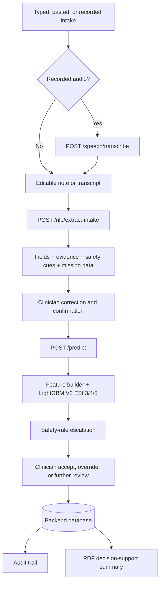

# TriageAI / SympDirect — Clinical Intake and ESI Care Routing

TriageAI is a review-first clinical decision-support workflow that turns structured or narrative intake into auditable ESI care routing while keeping clinicians in control of every consequential decision.

## Project Overview

TriageAI / SympDirect is a completed local demonstration of an end-to-end healthcare AI workflow. It combines a React and TypeScript frontend, a FastAPI backend, evidence-linked clinical NLP, a versioned LightGBM model registry, transparent safety-rule escalation, clinician review, database persistence, an audit trail, and backend-generated PDF decision-support summaries.

The project is designed as decision-support only. It does not diagnose patients, recommend treatment, make autonomous clinical decisions, or replace clinicians. Its completed demo-freeze state demonstrates the software and machine-learning engineering needed to move from a model artifact to a reviewable workflow; it does not establish production clinical readiness.

<!-- Screenshot: Command Center -->

## The Problem

Emergency intake information arrives in mixed forms: structured fields, pasted notes, typed observations, and spoken narratives. A useful system must organize that information without presenting unverified extraction as fact, expose high-risk signals, preserve the reasoning trail, and let a clinician make the final care-routing decision.

This creates a broader engineering problem than classification alone:

- unstructured notes must become reviewable structured intake;
- missing information must remain visible rather than being invented;
- model output and deterministic safety rules must be distinguishable;
- clinicians need explicit accept, override, and further-review actions;
- assessments, corrections, decisions, and reports must remain traceable.

## Why a Model-Only Prototype Was Insufficient

A notebook prediction cannot safely represent a clinical workflow. It does not provide controlled intake, evidence for extracted values, correction before inference, transparent escalation, persistent clinician review, or audit-ready reporting.

TriageAI therefore treats the model as one component inside a human-in-the-loop system. The backend validates inputs and constructs the approved feature schema, the model produces ESI 3/4/5 decision support, safety rules can escalate configured high-risk cases, and the clinician remains responsible for the final ESI care-routing decision.

## Project Goals

- Support typed, pasted, and recorded intake without automatically chaining transcription, extraction, or prediction.
- Convert clinical notes into editable structured fields with source-text evidence, safety cues, and missing-information indicators.
- Require clinician correction and confirmation before reviewed NLP fields can be submitted for prediction.
- Serve the approved model through a versioned backend registry with transparent safety-rule escalation.
- Persist assessments, predictions, reviews, evidence, audit events, and PDF summaries through backend-owned workflows.
- Deliver a repeatable React, FastAPI, SQLite, and Docker demonstration while stating clinical and production limitations clearly.

## End-to-End Workflow

1. **Capture intake.** The clinician types structured data, pastes a transcript, writes a note, or records audio in the New Intake workflow.
2. **Transcribe recorded audio.** An explicit action submits recorded audio as multipart form data to `POST /speech/transcribe`. Azure Speech is used when configured; otherwise, the backend returns a safe structured fallback and manual transcript entry remains available.
3. **Review the transcript.** The transcript stays editable and must be reviewed before it is copied into the clinical note. Raw recorded audio is not stored in the database.
4. **Extract structured intake.** An explicit request to `POST /nlp/extract-intake` returns reviewable fields, evidence snippets, configured safety cues, and missing vital-sign indicators.
5. **Inspect evidence.** Each recognized value is linked to supporting source text so the extraction is not presented as verified truth without context.
6. **Correct and confirm.** The clinician edits extracted values as needed and confirms review before prediction becomes available.
7. **Request decision support.** The reviewed structured intake is sent to `POST /predict`.
8. **Run inference.** The backend validates the request, builds the approved 273-feature representation, and runs the LightGBM V2 ESI 3/4/5 model from the versioned registry.
9. **Apply safety-rule escalation.** Transparent rules evaluate configured high-risk signals and can escalate the final routing output for urgent clinician review.
10. **Complete clinician review.** The clinician can accept the result, override it with documented context, or mark the assessment for further review.
11. **Preserve traceability.** The backend stores the assessment, prediction metadata, reviewed NLP evidence, clinician action, override reason where applicable, and report events in the audit trail.
12. **Generate documentation.** The backend creates a PDF decision-support summary containing the intake, model and safety output, clinician review, reviewed NLP evidence, and safety disclaimer.

<!-- Screenshot: New Intake -->
<!-- Screenshot: Clinical NLP review and evidence -->
<!-- Screenshot: Prediction and safety escalation -->
<!-- Screenshot: Clinician review -->
<!-- Screenshot: Audit Trail -->
<!-- Screenshot: Reports and PDF -->

## System Architecture

The architecture uses deliberate review gates. Recording does not trigger transcription, transcription does not trigger NLP extraction, extraction does not trigger prediction, and a decision-support result does not replace clinician review.

## Machine-Learning Model and Verified Metrics

The runtime model is loaded by FastAPI from the final versioned registry. The frontend never reads or executes model artifacts directly.

| Field | Verified value |
|---|---|
| Model | LightGBM V2 ESI 3/4/5 |
| Model version | `lightgbm_v2_weight_threshold_esi345` |
| Registry | `model_registry/esi_345_lightgbm_v2/` |
| Feature count | 273 |
| Class order | `ESI_3`, `ESI_4`, `ESI_5` |
| Decision threshold | 0.60 |
| Probability handling | Raw LightGBM probabilities retained |

Verified final evaluation metrics:

| Metric | Result |
|---|---:|
| Accuracy | **78.32%** |
| Macro F1 | **70.37%** |
| Weighted F1 | **78.88%** |
| ESI 5 F1 | **54.70%** |
| Unsafe ESI 3-to-ESI 5 downgrade rate | **0.68%** |

These metrics describe the selected model artifact and do not constitute prospective clinical validation. The classifier is limited to ESI 3, ESI 4, and ESI 5; configured higher-acuity concerns are handled through transparent safety-rule escalation and clinician review rather than invented model classes.

<!-- Screenshot: Model Monitoring -->

## Clinical NLP Safety Layer

The Clinical NLP Safety Layer is a deterministic, evidence-linked extraction service rather than a diagnostic chatbot. It can extract age, gender, chief complaint, symptoms, vital signs, configured safety cues, and missing vital-sign fields from a clinician-submitted note.

Its design makes uncertainty visible:

- extracted values are paired with source-text evidence;
- absent vital signs remain missing rather than being inferred;
- safety cues support attention and review but do not establish an ESI level;
- every response requires clinician review;
- structured values remain editable before prediction;
- reviewed evidence is preserved in the audit trail and PDF summary;
- raw note text is excluded from NLP audit metadata and PDF evidence.

This creates a defensible handoff between unstructured intake and structured model input without treating automated extraction as verified clinical truth.

## Human-in-the-Loop and Responsible AI Design

Human oversight is enforced through workflow behavior, not only disclaimer text. Transcription, NLP extraction, prediction, clinician review, and report generation are separate explicit actions. The clinician must review and correct extracted data before prediction and must accept, override, or defer the resulting care-routing output.

Transparent safety rules operate alongside the model for signals such as low oxygen saturation, altered-consciousness wording, chest pain with shortness of breath, severe bleeding wording, and pregnancy with bleeding wording. A triggered rule can escalate the routing result to ESI 2 as a safety safeguard, but it does not diagnose a condition or remove clinician responsibility.

The audit trail records meaningful workflow events, including prediction, reviewed NLP evidence, clinician review, override rationale, and report generation. The UI and PDF consistently frame outputs as decision-support only.

## Backend and Frontend Architecture

The **FastAPI backend** owns request validation, health and readiness checks, speech and NLP services, feature construction, model loading and inference, safety-rule evaluation, persistence, clinician review, audit logging, dashboard summaries, and ReportLab PDF generation. SQLAlchemy persists patients, assessments, predictions, clinician reviews, audit logs, and report metadata.

The **React frontend** uses Vite, TypeScript, Tailwind CSS, React Router, Recharts, and typed API services. It provides New Intake, Command Center, assessment queue and detail, clinician review, audit, reports, model monitoring, and system settings views. Loading, empty, error, and disconnected states make backend status visible.

The backend and database remain the source of truth. Browser storage and mock fixtures do not own real assessments, and official PDF summaries are generated server-side. SQLite supports the local demonstration; PostgreSQL is the recommended database for a controlled professional deployment.

<!-- Screenshot: Assessment Detail -->

## Key Engineering Decisions

- **Review-first orchestration:** explicit user actions prevent transcription, extraction, prediction, and review from becoming an opaque automated chain.
- **Backend source of truth:** React renders persisted API state instead of creating frontend-only clinical records or predictions.
- **Versioned model registry:** model, preprocessing artifacts, feature schema, class mapping, metadata, and threshold configuration are loaded together.
- **Evidence before trust:** NLP output carries source snippets, missing fields, and mandatory review metadata.
- **Layered safety:** model inference and deterministic safety-rule escalation remain visible as separate parts of the decision pathway.
- **Auditable correction:** reviewed structured evidence and clinician decisions are preserved downstream in audit and PDF workflows.
- **Safe integration fallback:** Azure Speech is optional, credentials remain backend-only, temporary audio files are deleted after processing, and manual transcript entry remains usable.
- **Portable persistence boundary:** SQLite enables a repeatable local demo while the SQLAlchemy design supports migration to managed PostgreSQL.

## Challenges Solved

**Turning notes into trustworthy model input.** The extraction layer links fields to evidence, surfaces missing information, and requires correction before inference.

**Keeping ML and clinical safeguards understandable.** The system distinguishes the LightGBM prediction from rule-based escalation and shows the final source of the routing output.

**Carrying evidence across the full workflow.** Reviewed NLP evidence is not lost after prediction; it remains visible in assessment details, the audit trail, and backend-generated PDF summaries.

**Replacing prototype state with a real application boundary.** React communicates with typed FastAPI contracts, while database-backed assessments, reviews, dashboards, and reports provide consistent state across views.

**Making demonstrations repeatable.** Docker Compose, local readiness checks, deterministic seed/reset utilities, generated demo records, and regression tests support a stable demo-freeze workflow.

## Testing and Final Validation

The final validation covered backend contracts and persistence, model loading, feature construction, NLP extraction, safety rules, clinician review, audit behavior, report and PDF generation, frontend API behavior, UI helpers, and the local full-stack path.

| Validation | Final result |
|---|---|
| Backend tests | **90 passed** |
| Frontend tests | **12 test files, 38 tests** |
| React production build | **Passed** |
| Docker full-stack run | **Passed** |
| Backend readiness | **Passed** |
| Model loaded | `true` |

These checks validate the local demonstration workflow and software integration. They do not represent clinical validation, real-world effectiveness, production security approval, or regulatory clearance.

## Outcome and Skills Demonstrated

The completed demo-freeze turns a trained classifier into a coherent clinical decision-support workflow with evidence-linked intake, clinician-controlled prediction, transparent safety escalation, persistent review, auditability, and professional PDF reporting.

The work demonstrates:

- applied machine-learning deployment and model-registry integration;
- class-imbalanced multiclass evaluation and threshold-aware inference;
- clinical-note information extraction with evidence and missing-data handling;
- FastAPI, Pydantic, SQLAlchemy, React, and TypeScript application engineering;
- typed frontend-backend contracts and resilient UI states;
- human-in-the-loop workflow and responsible AI design;
- audit logging, PDF generation, automated testing, CI, and Docker;
- clear separation between a validated software demonstration and clinical validation.

## Current Limitations

- TriageAI is a portfolio and educational demonstration, not a validated clinical system.
- It is decision-support only and does not diagnose, recommend treatment, make autonomous decisions, or replace clinicians.
- The model scope is limited to ESI 3/4/5 and its retrospective metrics do not establish prospective clinical safety or effectiveness.
- The NLP layer is bounded extraction logic and still requires clinician correction and confirmation.
- Azure Speech depends on external service configuration; the unconfigured path intentionally returns a safe fallback.
- SQLite, demo authentication behavior, local report storage, and local Docker execution are suitable for demonstration rather than clinical production.
- The project has not completed prospective clinical validation, workflow usability studies, subgroup fairness evaluation, regulatory assessment, or controlled organizational deployment.

## Production-Readiness Requirements

Future production consideration would require:

- prospective clinical validation;
- workflow usability studies;
- subgroup and fairness evaluation;
- calibration and drift monitoring;
- production authentication and role-based access control;
- managed PostgreSQL;
- privacy and security controls;
- managed secret storage;
- centralized observability;
- managed report storage;
- controlled cloud deployment;
- governance and regulatory assessment.

These are requirements for future assessment, not claims of current readiness.

## Repository and Portfolio Links

- [GitHub repository](https://github.com/chintan-02/triageai-esi-care-routing)
- [TriageAI portfolio case study](https://chintan-patel-ai.netlify.app/case-studies/triageai)
- [Chintan Patel portfolio](https://chintan-patel-ai.netlify.app/)
